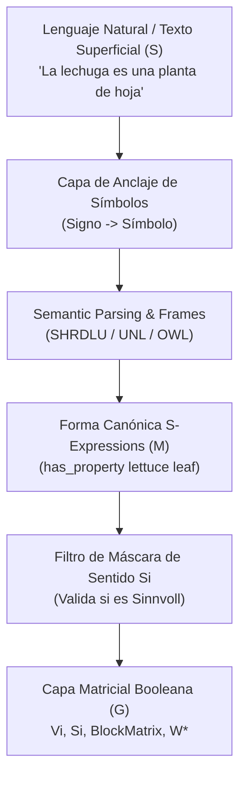

# Pipeline de Ingesta: Del Lenguaje Natural a Matrices Booleanas

Este documento define el flujo oficial de 5 etapas para transformar enunciados de lenguaje natural (o entradas de LLM) en coordenadas matriciales booleanas operables dentro del modelo **Matrix / Tractatus Knowledge Machine**.

---

## 1. El Marco SMG (Superficie, Significado, Grafo)

El paso de lenguaje a matrices se rige por la descomposición **SMG**:

- **Superficie ($S$):** El texto perceptible de entrada (ej. castellano, inglés, tokenización de LLMs).
- **Significado ($M$):** La representación intermedia canonizada mediante $S$-Expressions `(R a b)`.
- **Grafo / Matriz ($G$):** La partición del mundo $W_i$ materializada en matrices $V_i, S_i$ y operaciones bitwise.

---

## 2. Las 5 Etapas del Pipeline de Ingesta

### Etapa 1: Anclaje de Símbolos (*Symbol Grounding*)
- **Input:** Cadenas de caracteres / tokens externos.
- **Operación:** Se distingue entre el **Signo** (el término exterior: *"lechuga"*, *"lettuce"*, *"drei"*) y el **Símbolo** ($L_i$).
- **Mapeo:** Se consulta el registro del sistema (`logical_system_registry.py`) y se pliegan sinónimos usando la meta-relación `equivalent`.

### Etapa 2: Parseo Semántico y Frames (*Semantic Parsing*)
- **Input:** Oración o comando estructurado.
- **Operación:** Se construyen *Semantic Frames* (como en el prototipo SHRDLU: `ImperativeFrame`, `QueryFrame`, `EntityDescriptor`) o grafos semánticos UNL/OWL.
- **Propósito:** Determinar el objetivo de la acción (afirmación, consulta, comando de modificación) y los objetos involucrados.

### Etapa 3: Reducción a Forma Canónica ($S$-Expressions)
- **Input:** Frame Semántico.
- **Operación:** Se proyecta a la forma canónica textual obligatoria:
  $$(R \ a \ b)$$
- **Ejemplo:**
  * Texto: *"Pon el bloque rojo sobre el cubo azul"*
  * S-Expression: `(assert wigame:scene (on red-block blue-cube))`

### Etapa 4: Validación por la Máscara de Sentido ($S_i$)
- **Input:** Proposición `(R a b)`.
- **Operación:** El motor verifica si la relación $R$ entre $a$ y $b$ pertenece a la máscara de aplicabilidad semántica $S_i$.
- **Resultados:**
  * **Sinnvoll (Con sentido):** $S_i = 1$. Se procede a la ingesta en la Matriz de Verdad $V_i$.
  * **Unsinnig (Absurdo / Error de categoría):** $S_i = 0$. La proposición es rechazada antes de contaminar la base factual (ej. *"La lechuga tiene puerta"*).

### Etapa 5: Compilación y Cómputo Matricial ($V_i, W_i^*$)
- **Input:** Proposición válida $S_i = 1$.
- **Operación:**
  1. Se actualiza la Matriz de Verdad factual $V_i$.
  2. Se compilan las implicaciones a matrices de incidencia $I$ y cláusulas $(C^+, C^-)$.
  3. Se ejecuta la clausura transitiva $M_R^*$ o Modus Ponens matricial $v \otimes I^*$.
  4. Se proyecta la matriz operativa resultante:
     $$W_i^* = V_i \odot S_i$$

---

## 3. Ejemplo E2E: Del Texto a Bits

| Paso | Representación | Estado del Sistema |
| :--- | :--- | :--- |
| **Texto Libre** | `"El bloque rojo está sobre el cubo azul"` | Superficie $S$ desestructurada |
| **Grounding** | `red-block` (Objeto 1), `blue-cube` (Objeto 2), `on` (Relación) | Signos anclados a `Symbol` |
| **Frame** | `ImperativeFrame(action=assert, target=red-block, location=blue-cube)` | Intención semántica |
| **S-Expr** | `(assert wigame:scene (on red-block blue-cube))` | Forma canónica |
| **Filtro $S_i$** | $S_i[\text{red-block}, \text{blue-cube}] = 1$ | Proposición *Sinnvoll* |
| **Matriz $V_i$** | $V_i[\text{red-block}, \text{blue-cube}] = 1$ | Hecho afirmativo empírico |
| **Cómputo** | $W^* = V_i \odot S_i = 1$ | Coordenada booleana en $W_i$ |
