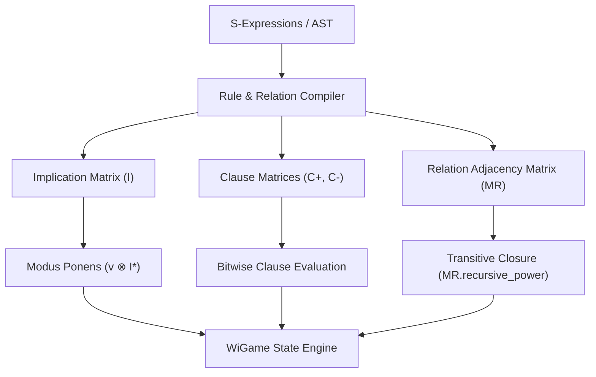

# Pure Boolean Matrix & Bitwise Inference Architecture

This document defines the architectural specification for implementing all logical inference, rule evaluation, and relation operations in Matrix as pure **Boolean Matrix** operations over the Boolean semiring $(\land, \lor)$ and bitwise masks.

---

## 1. Core Principles

1. **Matrix-First Evaluation**: All propositional evaluation, relation transitive closure, and deductive inference rules (such as Modus Ponens and Syllogisms) must be expressible as vector-matrix or matrix-matrix products over $\mathbb{B} = \{0, 1\}$.
2. **AST-Free Runtime Execution**: FBF ASTs are used exclusively during ingestion and parsing. During runtime execution and inference, formulas are compiled to Incidence Matrices ($I$) and Clause Matrices ($C^+, C^-$).
3. **Tripartite Sense-Truth Coupling**: Evaluation operates on the Hadamard product of Truth Matrix $V_i$ and Sense Mask $S_i$:
   $$W_i^* = V_i \odot S_i$$

---

## 2. Rule Compilation to Incidence Matrices

### A. Implication Matrix ($I$)
For a set of propositional implications $\{P_i \implies Q_j\}$, we construct an **Implication Matrix** $I \in \{0, 1\}^{N \times N}$, where:
$$I_{i, j} = 1 \iff (P_i \implies P_j)$$

Given a state vector of known true atoms $v \in \{0, 1\}^N$, one step of Modus Ponens is computed by Boolean matrix-vector multiplication:
$$v^{(1)} = v \lor (v \otimes I)$$

The full deductive closure under Modus Ponens and Hypothetical Syllogism is:
$$v^* = v \otimes I^* = v \otimes \Big(\bigvee_{k=0}^{N} I^k\Big)$$
where $I^*$ is computed in $O(\log N)$ matrix multiplications via recursive squaring (`BooleanMatrix.recursive_power()`).

### B. Clause Incidence Matrices $(C^+, C^-)$
For formulas in Conjunctive Normal Form (CNF), clauses are compiled into two matrices:
- $C^+_{m, n} = 1 \iff$ variable $x_n$ appears positively in clause $m$.
- $C^-_{m, n} = 1 \iff$ variable $x_n$ appears negated in clause $m$.

Clause satisfaction under valuation vector $v$ is evaluated bitwise:
$$\text{Sat}_m = \Big(\bigvee_n (v_n \land C^+_{m, n})\Big) \lor \Big(\bigvee_n (\neg v_n \land C^-_{m, n})\Big)$$

---

## 3. Relation Transitive Closure ($M_R^*$)

For a binary relation $R$ over domain terms $T$, the relation is represented as a square adjacency matrix $M_R \in \{0, 1\}^{|T| \times |T|}$.

- **Transitive Inference** ($aRb \land bRc \implies aRc$):
  Calculated as the matrix transitive closure:
  $$M_R^* = \bigvee_{k=1}^{|T|} M_R^k$$
- **Symmetric / Commutative Inference** ($aRb \implies bRa$):
  Calculated as:
  $$M_R^{\text{sym}} = M_R \lor M_R^T$$

---

## 4. Block Matrix Omnirepresentation

The global evaluation space of a local world $W_i$ is represented as a **Block Matrix**:

$$\mathbf{M} = \begin{pmatrix} 
\mathbf{WC_i} & \mathbf{S_i} \\ 
\mathbf{S_i^T} & \mathbf{V_i} 
\end{pmatrix}$$

Where:
- $\mathbf{WC_i}$: Context-to-Context routing matrix.
- $\mathbf{S_i}$: Context-to-Fact sense applicability mask.
- $\mathbf{V_i}$: Fact-to-Fact empirical truth matrix.

---

## 5. Execution Pipeline

