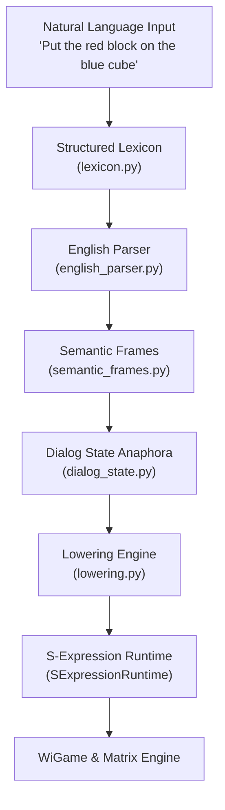

# SHRDLU Prototype Architecture & Lowering

This document describes the design and lowering mechanics of the **Proto-SHRDLU** client module (`prototypes/shrdlu/`).

---

## 1. Purpose & Boundary

The SHRDLU prototype serves as the top-level **Surface Layer** of the Matrix ecosystem:
- It accepts Controlled English natural language input (e.g., `"Put the red block on the blue cube."`).
- It extracts structured **Semantic Frames** (`ImperativeFrame`, `QueryFrame`).
- It resolves anaphoric references using a dialogue state memory (`DialogState`).
- It lowers semantic frames into canonical Matrix S-Expressions (`(assert wigame:scene (on red-block blue-cube))`).

To maintain clean architectural boundaries, this client lives under `prototypes/shrdlu/`, keeping `src/operational_model/` independent of English-specific grammar rules.

---

## 2. Core Components



### A. Lexicon (`lexicon.py`)
Inspired by historical SHRDLU dictionary structures (`dictio.lisp`), the lexicon supports:
- Single-word entries (nouns, adjectives, verbs, prepositions, determiners).
- Multi-word combination phrases (`pick up`, `on top of`, `put on`).

### B. English Parser (`english_parser.py`)
Parses shallow controlled English into strongly typed dataclass frames:
- `EntityDescriptor`: `noun`, `adjectives`, `specifier` (e.g., `"the red block"`).
- `ImperativeFrame`: `verb_phrase`, `target`, `location` (e.g., `"put"`, `target=red-block`, `location=blue-cube`).
- `QueryFrame`: `query_type`, `target`, `location`.

### C. Dialog State & Anaphora (`dialog_state.py`)
Tracks conversational focus across turns:
- Remembers recently mentioned referents (`red-block`, `blue-cube`).
- Resolves pronouns (`"it"`, `"that"`, `"them"`) to the most recent matching referent.

### D. Lowering Engine (`lowering.py`)
Translates high-level semantic frames into concrete Matrix operations:
- Grounding: maps entity descriptors to `SceneObject` symbols registered in the `WiGame` scene (`wigame:scene`).
- S-Expression generation: emits commands like `(assert wigame:scene (on red-block blue-cube))` or `(check wigame:scene (on red-block blue-cube))`.

---

## 3. Demo & Verification

To run the standalone SHRDLU interactive prototype:

```bash
python prototypes/shrdlu/proto.py --once "Put the red block on the blue cube."
```

To run the unit tests:

```bash
pytest tests/test_shrdlu_*.py
```
